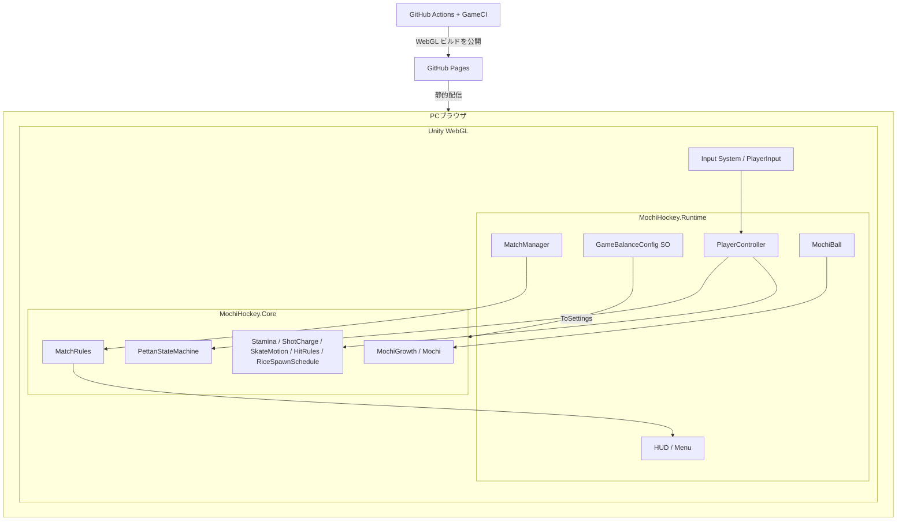

# pettan-mochi-hockey アーキテクチャ設計

**作成日**: 2026-11-17
**関連要件定義**: [requirements.md](../../spec/pettan-mochi-hockey/requirements.md)
**ヒアリング記録**: [design-interview.md](design-interview.md)

**【信頼性レベル凡例】**:
- 🔵 **青信号**: EARS要件定義書・設計文書・ユーザヒアリングを参考にした確実な設計
- 🟡 **黄信号**: EARS要件定義書・設計文書・ユーザヒアリングから妥当な推測による設計
- 🔴 **赤信号**: EARS要件定義書・設計文書・ユーザヒアリングにない推測による設計

---

## システム概要 🔵

**信頼性**: 🔵 *requirements.md 概要・PRD 1章*

PC ブラウザ（Unity WebGL）で動く 2〜4 人ローカル対戦のアーケードスポーツゲーム。サーバー・DB・API は持たず、GitHub Pages から静的に配信する。ゲームロジックは UnityEngine 非依存の Core 層に置き、MonoBehaviour は入力・物理・見た目と Core をつなぐ薄い層にする。

## アーキテクチャパターン 🔵

**信頼性**: 🔵 *CLAUDE.md・PRD 7.1*

- **パターン**: 2 層構成（Core ロジック層 ＋ Runtime アダプタ層）。Core は「状態 ＋ `Tick(deltaTime)` ＋ イベント」で表現し、Runtime が毎フレーム Core を進めて結果を Transform / Rigidbody / UI に反映する
- **選択理由**:
  - EditMode テストで Core を高速に TDD できる（Unity 経験が浅くても仕様をテストで確認しながら進められる）
  - 時間進行をすべて `Tick(dt)` で受けるため、テストで時間を自由に進められる
  - 調整値は `GameBalanceConfig`（ScriptableObject）→ Core 用のプレーンな設定クラスに変換して渡すので、Core は ScriptableObject に依存しない

## アセンブリ構成 🔵

**信頼性**: 🔵 *PRD 7.1・tech-stack.md*

| アセンブリ | 場所 | 内容 | 参照 |
|---|---|---|---|
| `MochiHockey.Core` | `Assets/_Project/Scripts/Core/` | 純粋 C# ロジック（`noEngineReferences: true`） | なし |
| `MochiHockey.Runtime` | `Assets/_Project/Scripts/Runtime/` | MonoBehaviour、ScriptableObject、入力、物理、UI、VFX | Core, Unity.InputSystem, Unity.Cinemachine |
| `MochiHockey.Tests.EditMode` | `Assets/_Project/Tests/EditMode/` | Core の単体テスト | Core |
| `MochiHockey.Tests.PlayMode` | `Assets/_Project/Tests/PlayMode/` | 物理・統合テスト | Runtime, Core |

- Core のベクトル型は `System.Numerics.Vector2`（リンクの床面 XZ 平面）を使う。Runtime 側で `UnityEngine.Vector3(x, y, z)` に変換する 🟡 *noEngineReferences の制約から妥当な推測*

## コンポーネント構成

### Core 層（`MochiHockey.Core`） 🔵

**信頼性**: 🔵 *PRD 7.2・ヒアリング*（型の詳細は [interfaces.cs](interfaces.cs)）

| クラス | 役割 | 関連要件 |
|---|---|---|
| `BalanceSettings`（＋子設定クラス） | Core が使う調整値の入れ物（プレーンな C#） | REQ-402 |
| `MochiGrowth` | もち米数 → レベル・得点・速度倍率・サイズ倍率 | REQ-013 |
| `Mochi` | 餅の状態（累計もち米数、保持者、再吸着禁止タイマー） | REQ-012, 014, 024 |
| `PettanStateMachine` | 被弾後の状態遷移と、吹っ飛び軌道・壁張り付き位置の計算 | REQ-031〜036 |
| `RinkBounds` | リンク外周の壁（矩形）。直線と壁の交差判定、壁の法線 | REQ-033 |
| `HitRules` | 杵が当たるか（味方・張り付き中・無敵中は当たらない）、同時ヒット | REQ-006, 035, 036 |
| `MatchRules` | スコア、試合フェーズ（キックオフ／通常／サドンデス／終了）、タイマー、勝敗、ゴール後の再出現待ち | REQ-001〜005 |
| `RiceSpawnSchedule` | もち米の補充タイミングと出現位置の抽選（`IRandom` 注入） | REQ-011 |
| `Stamina` | スタミナ消費・回復、ダッシュ可否 | REQ-026 |
| `ShotCharge` | チャージ時間 → チャージ段階 | REQ-023 |
| `SkateMotion` | 慣性移動（入力 → 目標速度 → 加速・摩擦） | REQ-021 |

### Runtime 層（`MochiHockey.Runtime`） 🔵

**信頼性**: 🔵 *PRD 7.2・ヒアリング*

| クラス | 役割 |
|---|---|
| `GameBalanceConfig`（ScriptableObject） | 調整値の置き場。`ToSettings()` で `BalanceSettings` を作る |
| `MatchSession`（DontDestroyOnLoad） | Menu シーンで決めた参加者（デバイス・チーム・番号）を Match シーンへ渡す |
| `PlayerJoinManager` | `PlayerInputManager` による参加受付、デバイス割り当て、キーボード 2 人分のスキーム |
| `MatchManager` | Match シーンの司令塔。`MatchRules` を進め、キックオフ・ゴール後の再出現・ポーズ・リザルト遷移を管理 |
| `PlayerController` | 入力を受けて `SkateMotion` / `Stamina` / `ShotCharge` を進め、Rigidbody に速度を反映。被弾中は `PettanStateMachine` の位置・向き・スケールを kinematic で反映 |
| `MalletHitbox` | 杵スイングの当たり判定の有効化と、ヒット候補の収集 → `HitRules` で判定 |
| `MochiBall` | `Mochi` の状態を見た目・コライダー・物理に反映。保持中は杵の先に追従、非保持時は Rigidbody |
| `MochiRiceSpawner` | `RiceSpawnSchedule` に従いもち米を出す（オブジェクトプール） |
| `GoalPost` | 餅の侵入を検知して `MatchManager` に通知 |
| `CameraRig` | Cinemachine Target Group に全プレイヤーと餅を登録 |
| `HudPresenter`（UI Toolkit） | スコア・残り時間・GOAL! 演出 |
| `WorldGaugePresenter`（uGUI World Space） | 餅の頭上ゲージ、足元リング・スタミナ・チャージ |
| `MenuPresenter`（UI Toolkit） | タイトル・対戦設定・ポーズ・リザルト画面 |
| `AudioUnlocker` | 最初のユーザー入力で音声を有効化 |

## システム構成図 🔵

**信頼性**: 🔵 *PRD 7章・9章・ヒアリング*



## シーン構成 🔵

**信頼性**: 🔵 *ヒアリング Q2（design-interview.md）*

| シーン | 内容 |
|---|---|
| `Menu` | ローディング後の最初のシーン。タイトル → 対戦設定（人数・チーム・デバイス割り当て） |
| `Match` | 試合 ⇄ ポーズ → リザルト（もう一度＝Match を再ロード／タイトルへ＝Menu をロード） |

- 参加者情報は `MatchSession` に保持し、シーンをまたいで引き継ぐ 🔵
- PlayerInput はシーン切り替え時に作り直し、`MatchSession` のデバイス情報からペアリングし直す 🟡 *Input System の一般的な使い方から妥当な推測*

## 吹っ飛び（Launched）の実装方針 🔵

**信頼性**: 🔵 *ヒアリング Q3（Core で軌道計算）*

- 被弾者の軌道は `PettanStateMachine` が計算する。攻撃者の正面方向へ、高さを変えずに水平に一定速度で直進し（ドラゴンボールのように殴り飛ばされるイメージ）、壁に当たると反射して跳ね返る。`LaunchWallBounces` 回（既定 1 回）跳ね返ったあと、次に当たった壁に貼り付く 🔵 *ユーザー指示（2026-11-18）：床ではねずに壁で 1 回跳ね返る。REQ-033 の「床か壁で 1 回バウンド」のうち壁を採用*
- 壁到達は `RinkBounds`（矩形）との交差で判定し、到達点と壁の法線を Stuck 状態に渡す 🔵
- 壁に届くまで直進を続ける（矩形リンク内の直進なので必ずどこかの壁に届く）。安全のため、被弾から `LaunchMaxDuration` を超えても貼り付けなければその場で Recover 🔵 *ヒアリング（要件定義 Q5）*
- 被弾中の Rigidbody は `isKinematic = true` にし、Core が出した位置を `MovePosition` で反映する。Launched 中は他プレイヤーとの衝突を無視するレイヤーに切り替え、Stuck 中はコライダーを無効にする 🔵 *REQ-035*
- ゴール（臼）はリンク内のオブジェクトであり、吹っ飛び中はすり抜ける 🟡 *妥当な推測*

## ディレクトリ構造 🔵

**信頼性**: 🔵 *PRD 7.3・tech-stack.md*

```
Assets/_Project/
├── Scripts/
│   ├── Core/                 # MochiHockey.Core.asmdef
│   │   ├── Settings/         # BalanceSettings ほか
│   │   ├── Mochi/            # MochiGrowth, Mochi
│   │   ├── Pettan/           # PettanStateMachine, RinkBounds, HitRules
│   │   ├── Match/            # MatchRules
│   │   ├── Player/           # SkateMotion, Stamina, ShotCharge
│   │   ├── Rice/             # RiceSpawnSchedule
│   │   └── Common/           # IRandom など
│   └── Runtime/              # MochiHockey.Runtime.asmdef
│       ├── Config/  Match/  Player/  Mochi/  Rice/  Camera/  UI/  Audio/
├── Tests/
│   ├── EditMode/             # MochiHockey.Tests.EditMode.asmdef
│   └── PlayMode/             # MochiHockey.Tests.PlayMode.asmdef
├── Scenes/                   # Menu.unity, Match.unity
├── ScriptableObjects/        # GameBalanceConfig.asset
├── Prefabs/  UI/  Art/  Audio/  VFX/
└── WebGLTemplates/ → Assets/WebGLTemplates/PettanTemplate/（Unity の規約で Assets 直下）
```

## 非機能要件の実現方法

### パフォーマンス 🟡

**信頼性**: 🟡 *PRD 6章から妥当な推測*

- **60fps**: Core はアロケーションを避ける（毎フレーム new しない、イベントは struct または事前確保リスト）。もち米はオブジェクトプールで使い回す
- **入力遅延 3 フレーム以内**: 入力は `Update` で読み、同じフレームで Core を進める。物理反映は `FixedUpdate`（Fixed Timestep は 1/60）
- **ビルドサイズ 50MB 以下**: テクスチャ 1024px 以下、音声は Vorbis 圧縮、BGM はストリーミング。Managed Stripping Level を High にする
- **ロード 15 秒以内**: Brotli 圧縮 ＋ Decompression Fallback、カスタム WebGL テンプレートで進捗バー

### セキュリティ 🔵

**信頼性**: 🔵 *requirements.md 非機能要件*

- サーバー・個人情報・認証なし。保存は PlayerPrefs の設定値のみ
- Unity ライセンス情報は GitHub Secrets のみに置く

### 可用性 🔵

**信頼性**: 🔵 *PRD 9章*

- GitHub Pages の静的配信に依存。main への push で自動デプロイ、テスト失敗時はデプロイしない

## 技術的制約

### WebGL 制約 🔵

**信頼性**: 🔵 *CLAUDE.md・PRD 10章*

- スレッド、System.IO のファイル操作、ソケット、Compute Shader を使わない
- ユーザー操作前に音を鳴らせない → `AudioUnlocker`
- ゲームパッドはボタンを一度押すまで認識されない → 対戦設定画面で案内
- GitHub Pages は Content-Encoding を設定できない → Decompression Fallback

### 開発制約 🔵

**信頼性**: 🔵 *CLAUDE.md*

- 調整値は `GameBalanceConfig` に置く。Core はそこから変換された `BalanceSettings` だけを見る
- シーン・プレハブの YAML は直接編集しない。エディタでの作業は手順として書き出す

### 互換性制約 🔵

**信頼性**: 🔵 *tech-stack.md・ヒアリング*

- Unity 6000.6.8f1 / URP 17.6 / WebGL 2.0
- Chrome/Edge 最新版は必須、Firefox は努力目標、Safari は対象外

## 関連文書

- **データフロー**: [dataflow.md](dataflow.md)
- **型定義（C#）**: [interfaces.cs](interfaces.cs)
- **要件定義**: [requirements.md](../../spec/pettan-mochi-hockey/requirements.md)
- **技術スタック**: [tech-stack.md](../../tech-stack.md)

## 信頼性レベルサマリー

- 🔵 青信号: 17件 (77%)
- 🟡 黄信号: 5件 (23%)
- 🔴 赤信号: 0件 (0%)

**品質評価**: 高品質
