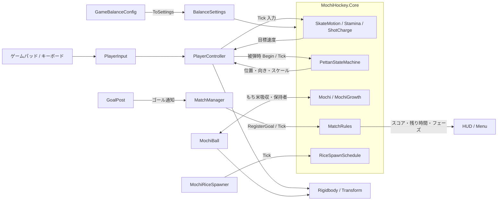
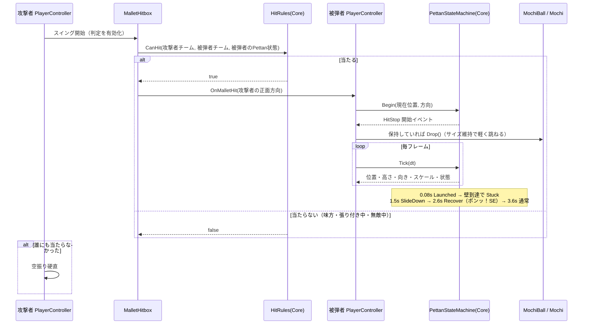
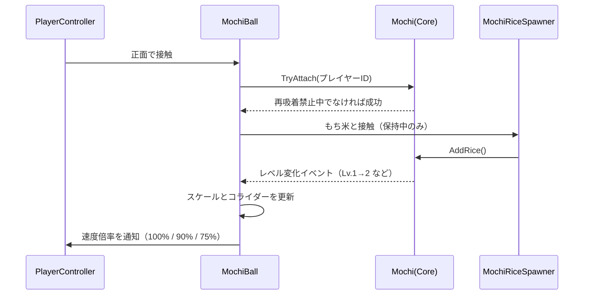
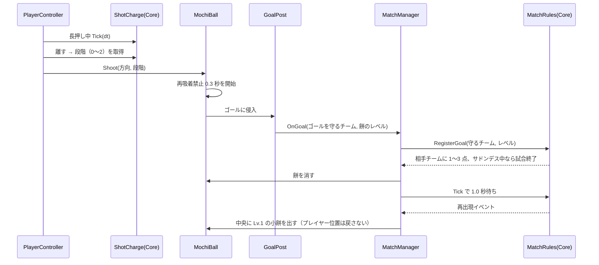
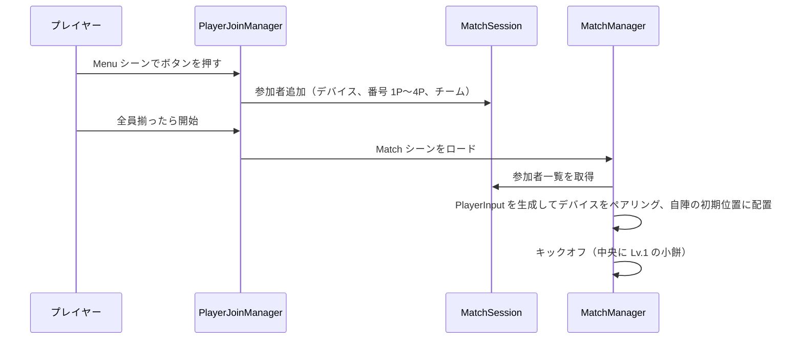
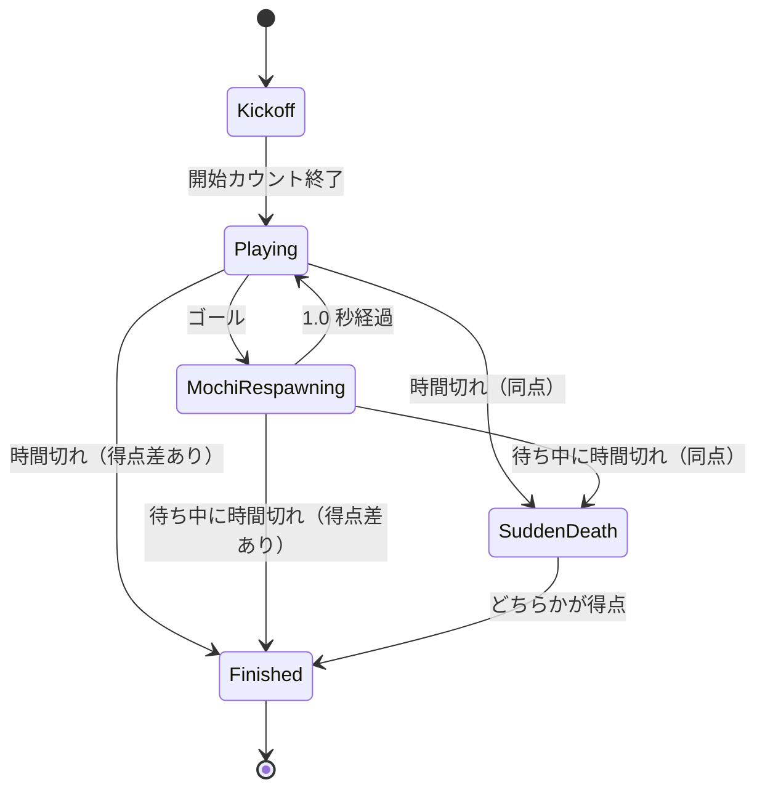
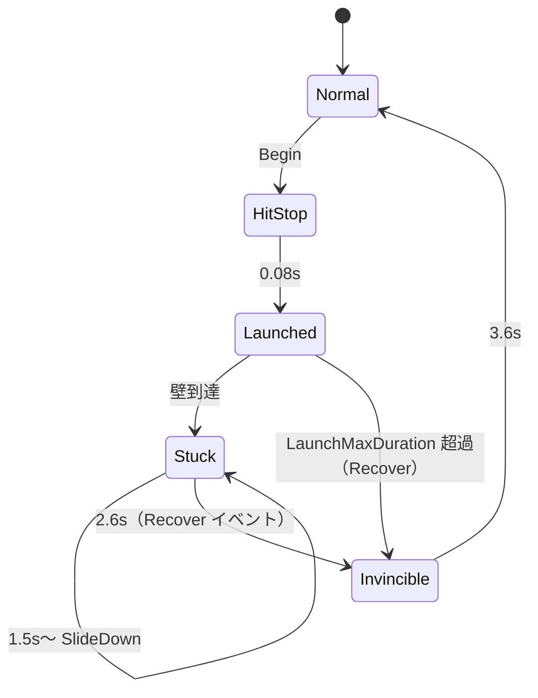

# pettan-mochi-hockey データフロー図

**作成日**: 2026-11-17
**関連アーキテクチャ**: [architecture.md](architecture.md)
**関連要件定義**: [requirements.md](../../spec/pettan-mochi-hockey/requirements.md)

**【信頼性レベル凡例】**:
- 🔵 **青信号**: EARS要件定義書・設計文書・ユーザヒアリングを参考にした確実なフロー
- 🟡 **黄信号**: EARS要件定義書・設計文書・ユーザヒアリングから妥当な推測によるフロー
- 🔴 **赤信号**: EARS要件定義書・設計文書・ユーザヒアリングにない推測によるフロー

---

## システム全体のデータフロー 🔵

**信頼性**: 🔵 *architecture.md・PRD 7.1*

## フレーム内の処理順 🟡

**信頼性**: 🟡 *入力遅延要件（3フレーム以内）から妥当な推測*

1. `Update`: `PlayerInput` から入力を読む（移動・ボタン押下／長押し）
2. `Update`: `MatchManager` が `MatchRules.Tick(dt)` を呼ぶ（ポーズ中は dt=0）
3. `Update`: 各 `PlayerController` が `SkateMotion` / `Stamina` / `ShotCharge` / `PettanStateMachine` を `Tick(dt)`
4. `FixedUpdate`: 通常時は Rigidbody に目標速度を反映、被弾中は kinematic で Core の位置を `MovePosition`
5. `OnTrigger*` / `OnCollision*`: 杵ヒット、餅の吸着、もち米吸収、ゴール侵入を Core に通知
6. `LateUpdate`: HUD・ワールドゲージ・カメラを更新

- Script Execution Order: `MatchManager` → `PlayerController` → `MochiBall` → Presenter 類 🟡

## 主要機能のデータフロー

### 機能1: 杵スイング → Pettan → 復帰 🔵

**信頼性**: 🔵 *REQ-025, 031〜036・ヒアリング*

**詳細ステップ**:
1. 同じフレームで 2 人が互いに当てた場合は、両方の `Begin` を呼ぶ（`HitRules` はスイング開始時点の状態で判定する） 🔵 *REQ-036*
2. Lv.3 シュートの巻き込みも、同じ `Begin` を呼ぶ（方向はシュート方向） 🔵 *REQ-015*
3. 吹っ飛びは水平に直進し、壁で `LaunchWallBounces` 回（既定 1 回）跳ね返ってから次の壁に貼り付く。被弾から `LaunchMaxDuration` を超えても貼り付けなければその場で Recover 🔵 *REQ-033・ユーザー指示（2026-11-18）*

### 機能2: ドリブル → もち米吸収 → 成長 🔵

**信頼性**: 🔵 *REQ-012〜014, 022, 024*

### 機能3: シュート → ゴール → 再出現 🔵

**信頼性**: 🔵 *REQ-003, 004, 023, 024・ヒアリング*

### 機能4: 参加受付 → 試合開始 🔵

**信頼性**: 🔵 *REQ-041〜043, 051・ヒアリング（2 シーン構成）*

## 状態管理フロー

### 試合フェーズ（MatchRules） 🔵

**信頼性**: 🔵 *REQ-001〜005*

- サドンデス開始時は、餅が場になければ中央に出し直す 🟡 *妥当な推測*
- ポーズは `MatchRules` の外（Runtime）で dt=0 として扱う 🟡

### 被弾ステート（PettanStateMachine） 🔵

**信頼性**: 🔵 *REQ-031〜035*

| 状態 | 操作 | 被弾 | コライダー | スケール |
|---|---|---|---|---|
| Normal | 可 | する | 有効 | 1.0 |
| HitStop | 不可 | しない | 有効 | 1.0 |
| Launched | 不可 | しない | 他プレイヤーとは衝突しない | 1.0 |
| Stuck | 不可 | しない | 無効 | (1.3, 1.3, 0.05) |
| Invincible | 可 | しない | 有効 | 1.0（点滅） |

- HitStop 中の被弾可否は要件に明記がないため「しない」とする 🟡

## エラーハンドリング 🟡

**信頼性**: 🟡 *WebGL 環境から妥当な推測*

- **ゲームパッドの切断**: そのプレイヤーの入力をゼロ扱いにし、試合を自動でポーズ。再接続で再開
- **`GameBalanceConfig` 未設定**: Runtime 起動時に `Debug.LogError` を出して `MatchManager` を無効にする（Core に既定値は持たせない。数値は GameBalanceConfig だけに置くため）
- **Core の不正値（負の dt、負のもち米数など）**: `ArgumentOutOfRangeException` を投げ、EditMode テストで検出する

## 関連文書

- **アーキテクチャ**: [architecture.md](architecture.md)
- **型定義（C#）**: [interfaces.cs](interfaces.cs)
- **要件定義**: [requirements.md](../../spec/pettan-mochi-hockey/requirements.md)

## 信頼性レベルサマリー

- 🔵 青信号: 12件 (63%)
- 🟡 黄信号: 7件 (37%)
- 🔴 赤信号: 0件 (0%)

**品質評価**: 高品質（🟡 は実装時に確認すればよい細部）
